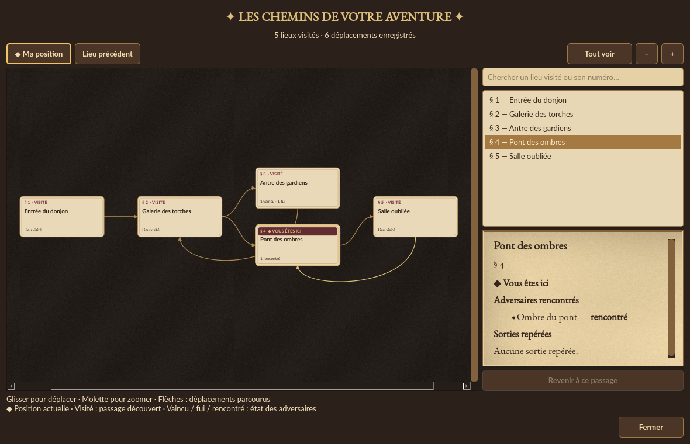

# Carte d’exploration

La carte affiche les lieux visités sur des vignettes de parchemin, reliées par les
flèches des déplacements effectivement enregistrés. Sa disposition est un schéma
des liaisons découvertes.

- **Vous êtes ici** : bandeau pourpre et doré sur la position actuelle.
- **Visité** : passage déjà découvert, avec son titre et son numéro.
- **Vaincu / fui / rencontré** : bilan des adversaires mémorisés dans ce lieu ;
  le panneau de droite conserve le nom et le statut individuel de chacun.
- Les sorties repérées vers un lieu inconnu indiquent uniquement son numéro et
  « non exploré ». Son titre et ses monstres restent cachés.

## Commandes

Glisser sur le fond déplace la carte. La molette ou **− / +** règle le zoom.
**Tout voir** ajuste l’ensemble du parcours à la fenêtre. **Ma position** recentre
le lieu actuel à taille lisible ; **Lieu précédent** retrouve le passage d’où
vient le dernier déplacement vers la position actuelle.

L’index de droite permet de chercher un lieu visité par son nom ou son numéro,
puis de le sélectionner à la souris ou au clavier. Sélectionner une vignette ou
un lien dans les détails consulte ce lieu sans modifier la partie.
**Revenir à ce passage** conserve explicitement la navigation offerte par
l’ancienne carte. La fenêtre peut être agrandie avec les commandes natives.

## Maintenance

`exploration_map.py` construit une copie des lieux découverts et des rencontres
mémorisées, puis dessine le graphe avec les widgets graphiques Qt existants.
Aucune dépendance supplémentaire ni modification du format de sauvegarde.
Les chemins éditoriaux vérifiés du catalogue restent prioritaires sur les liens
extraits du PDF. Zoom, sélection, recherche et recentrage ne sont pas des actions
de jeu et ne créent pas d’entrée dans l’historique d’annulation.
