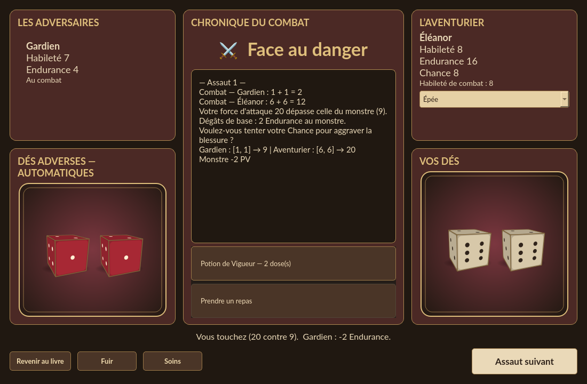
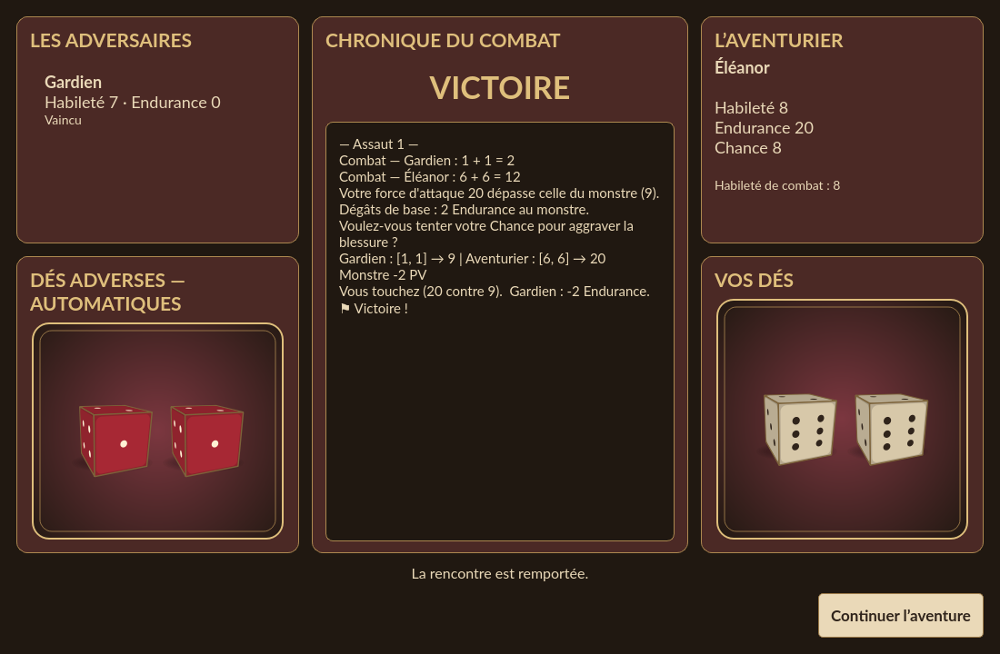

# Le champ de bataille

**⚔ Combattre ⚔**, au-dessus de la sacoche et visible seulement lorsqu'un combat
est disponible, ouvre ou rouvre une fenêtre dédiée sans réinitialiser l'adversaire
préparé par le livre.

- À gauche : les monstres de la rencontre, leurs Habileté et Endurance, leur
  statut et le plateau de dés rouges à points clairs.
- À droite : nom du héros, Habileté, Endurance, Chance et Habileté effective de
  combat, puis les mêmes dés ivoire que ceux des événements.
- Au centre : chronique chronologique des jets, forces d'attaque, dégâts et
  décisions, conservée pendant toute la rencontre, même à plusieurs adversaires.

## Déroulement

Les dés adverses partent automatiquement au début de l'assaut. **Lancer mes dés**
déclenche ceux du héros. Les forces d'attaque et blessures sont calculées par le
moteur existant avec les faces affichées. Si une décision de Chance est possible,
**Tenter ma Chance** et **Sans Chance** apparaissent dans cette même fenêtre.
Les jets de Chance et de protection utilisent le plateau du héros.

La fiche du personnage et les valeurs du combat utilisent le même état : les
blessures, soins ou dépenses de Chance sont répercutés dès leur application.
Le nombre d'assauts, les équipements et les règles particulières restent ceux
du livre. **Fuir** et **Soins** sont toujours présents en bas et grisés s'ils ne
sont pas utilisables. Choix de cible et stratégies restent dans la zone centrale,
qui défile si nécessaire ; dans La Forêt de la Malédiction, les commandes **Cibler**
n'apparaissent que si au moins deux adversaires sont encore debout. **Assaut suivant** lance le prochain assaut : les dés
rouges partent automatiquement, puis le joueur lance les blancs.

Le journal possède sa propre barre de défilement verticale et garde tous les
coups de la rencontre. Les actions longues reviennent à la ligne dans une zone
défilante séparée ; elles ne débordent plus sur le texte de résolution ni sur les
commandes du bas, y compris dans une fenêtre basse.

## Fuite, soins et équipement

**Fuir** tient compte de la destination, du nombre d'assauts requis, de la survie
des combattants et des règles particulières de la rencontre. Une fuite autorisée
dès le début peut être choisie avant tout lancer adverse. Le bouton ne permet pas
d'interrompre un assaut après avoir vu ses dés ; la pénalité et les éventuels tests
de Chance sont ceux du moteur du livre.

**Soins** affiche les options dans la même fenêtre. Une potion disponible et utile
peut être bue entre les assauts ou pendant les pauses de décision du joueur,
sans remplacer les dés déjà tirés. La Potion de Bonne Fortune augmente aussi le
maximum de Chance. Les repas sont interdits pendant le combat ; après la victoire,
ils restent possibles uniquement si le passage l'autorise, avec des provisions et
une autorisation non consommée. Un soin pris pendant l'assaut est annulé avec cet
assaut ; un soin entre les assauts constitue sa propre action annulable.

Les sélecteurs d'arme et de bouclier sont sur la carte du héros. Ils utilisent le
même équipement que la sacoche et sont désactivés pendant la résolution d'un assaut.
Il n'est donc plus nécessaire de quitter le combat pour ces commandes.

Les onglets **Combat & soins** et **Dés** ont disparu du lecteur. Hors combat,
**Soins** propose les soins autorisés ; **Actions…** conserve les dés libres,
la navigation manuelle, le prologue et la correction des Provisions et de l'Or.

Les séquences continuent dans la même fenêtre. **VICTOIRE** est affiché une fois
toute la rencontre gagnée, puis **Continuer l'aventure** rend la main au récit.
Une fuite ou une interruption imposée par le livre ne devient pas artificiellement
une victoire. Si l'Endurance du héros tombe à zéro, **DÉFAITE** s'affiche, puis
la fenêtre laisse place à la page de fin d'aventure après environ 1,8 seconde.

## Revenir au livre

**Revenir au livre**, Échap ou la croix suspendent la fenêtre. Si un assaut est
déjà commencé, il est d'abord terminé avec les dés déjà tirés, sans dépense de
Chance facultative : fermer ne permet pas d'éviter une blessure ou de relancer.
La fenêtre peut ensuite être rouverte et garde sa chronique dans la session
courante. La suspension visuelle n'est pas une fuite et n'affranchit pas des
restrictions de passage du livre.

Une nouvelle partie, une autre rencontre ou une restauration par Undo / chargement
abandonnent cette chronique visuelle pour ne pas conserver des coups qui ne
correspondent plus à l'état restauré. Les sauvegardes de jeu gardent leur format.

## Maintenance et tests

`CombatDialog` ne remplace pas le moteur. Il appelle `MainWindow.combat_round`,
toujours suivi par `_track_action` : un assaut complet, y compris ses phases
particulières, reste une seule action annulable et autosauvegardée.

`_combat_dialog` désigne la vue active uniquement pendant son `exec`. `_roll`
y présente les jets au lieu d'ouvrir `DiceDialog`. Un `QEventLoop` local attend
la fin du mouvement ou le clic requis, tout en laissant Qt afficher les changements.
Le hasard est consommé uniquement par le contrôleur ; la vue reçoit les faces.
La couleur et la légende optionnelles de `DiceCanvas` permettent de réutiliser
la même géométrie et les mêmes trajectoires pour les deux camps.

`busy` interdit une deuxième action pendant ces attentes. Les minuteries sont
des enfants Qt du dialogue, arrêtés à la fermeture ; elles ne rappellent pas un
objet C++ détruit. Les actions du livre sont des copies de ses boutons marqués
`combatAction`, reliées à leurs contrôles d'origine. Les règles de coût ou de
disponibilité ne sont donc pas réimplémentées dans la vue.

Les tests couvrent les combats simples, la Chance, la synchronisation de fiche,
les séquences, les groupes de squelettes, le Crocodile, les Piranhas, les monstres
errants, la créature aux paragraphes successifs, le souffle mortel, la fuite,
la fermeture au milieu d'un jet et la reprise de la chronique. Les captures de
cette page utilisent exclusivement une rencontre synthétique, sans texte du PDF.
