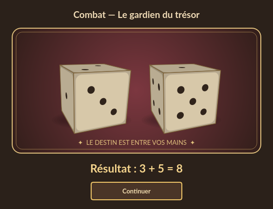

# Le lancer du destin

Hors combat, chaque jet réglementaire de **1d6 ou 2d6** ouvre une fenêtre sur un plateau de
velours aux couleurs du thème courant : dés ivoire en perspective, rotations,
rebonds, ombres et son du lancer. Le résultat est tiré une seule fois par le
moteur ; l'animation se termine sur les faces effectivement utilisées.

## Utilisation

- Le lancer dure environ **1,25 seconde**. Les faces finales et le total
  restent affichés jusqu'au clic sur **Continuer**.
- **Passer l'animation**, Entrée, Échap ou la croix pendant le mouvement
  révèlent immédiatement les résultats. Ils ne relancent pas les dés.
- Une fois les résultats visibles, **Continuer**, Entrée, Échap ou la croix
  rendent la main au jeu avec ces mêmes valeurs.
- Le titre précise le contexte : création d'une caractéristique, Chance,
  attaque de l'adversaire, attaque du héros ou protection particulière.

Dans la [fenêtre de combat](combat-popup.md), les plateaux sont intégrés : les
deux dés rouges de l'adversaire partent automatiquement, puis le joueur lance
ses dés blancs. Les tests de Chance et jets de protection éventuels utilisent
également le plateau intégré. Les rencontres particulières utilisent le même
point de tirage. Il n'existe pas de bouton de relance
dans cette fenêtre : les relances de création restent limitées par les règles.

Les variantes libres **3d6 et 1d20** de l'outil Dés conservent leur affichage
classique. Le plateau animé concerne un ou deux dés à six faces.

## Maintenance

`MainWindow._roll` est le point de passage unique : tirage, présentation, retour
des faces et de la somme. `_show_dice_roll` n'écrit ni sauvegarde ni historique.
Les effets du jeu sont résolus après la fermeture du dialogue ; un assaut
complet reste une seule action annulable. Charger, Undo et Redo n'animent pas
des jets déjà résolus.

`dice_dialog.py` n'utilise aucun générateur aléatoire. Les six faces, leurs normales
et les positions des points sont exprimées en 3D. Chaque cube tourne vers la face
imposée, puis reçoit une inclinaison de présentation. Le rendu trie les faces
visibles par profondeur et projette aussi les points sur le plan de leur face.
Il s'agit d'une trajectoire animée en rendu logiciel, sans simulation physique.
Il n'y a ni OpenGL, ni WebEngine, ni accès réseau, ni nouvelle dépendance à embarquer.

`QElapsedTimer` mesure la progression indépendamment du nombre d'images réellement
dessinées. Un `QTimer` demande des rafraîchissements toutes les 16 ms. La fermeture
arrête la minuterie ; les résultats reçus sont immuables et ne dépendent pas de
la durée, de la taille de fenêtre ou de la commande utilisée pour continuer.

Sur les plateformes Qt `offscreen` et `minimal`, le contrôleur ne crée pas de
fenêtre modale pour les jets de jeu. Les tests construisent le plateau directement
et couvrent également une vraie boucle modale Qt, la minuterie, les faces finales,
le hasard et la restauration du combat. Le contrôle visuel et sonore reste à
effectuer sur Windows, depuis la source puis depuis le ZIP compilé.
