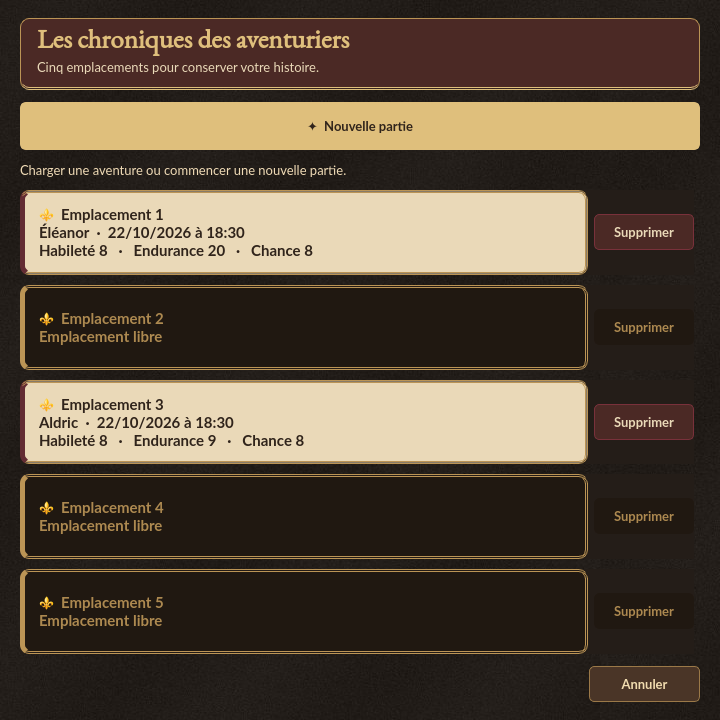
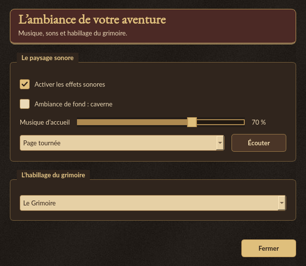

# Fenêtres secondaires du grimoire

Les fenêtres de sauvegarde, d’import PDF, d’ambiance et de saisie utilisent les
mêmes bandeaux dorés, surfaces de cuir, cadres arrondis et boutons. Les règles
reprennent ce bandeau et leur fenêtre s’adapte à l’espace disponible sur l’écran.
Les confirmations conservent leurs blasons et mettent en valeur leur choix par
défaut, sans changer ce choix.

## Chroniques

Les cinq emplacements présentent leurs métadonnées sur des cartes de parchemin.
Les emplacements indisponibles au chargement et les suppressions impossibles
sont assombris. La liste défile sur les petits écrans ; un nom trop long est
écourté à l’affichage et reste disponible intégralement dans l’infobulle et
pour les lecteurs d’écran. Les confirmations de nouvelle partie, de remplacement
et de suppression conservent leur fonctionnement.

## Ambiance

Les sons et la musique sont réunis dans « Le paysage sonore » ; le choix du thème
apparaît dans « L’habillage du grimoire ». Les cases à cocher et le curseur
reprennent la palette du thème. Les réglages restent mémorisés immédiatement.

## Maintenance

`dialog_chrome.py` fournit le bandeau commun, les icônes des dossiers et documents
du sélecteur PDF et les retouches des dialogues Qt standards. Le filtre global
les applique à l’ouverture ; l’import PDF prépare aussi directement son sélecteur.
Les contrôles, valeurs, boutons par défaut et résultats modaux restent gérés par
Qt. Le bandeau ne contient pas de croix de fermeture supplémentaire.

Le QSS du thème centralise les couleurs et les états des boutons. L’asset
`checkmark` du manifeste désigne la coche SVG ; un thème peut lui substituer son
propre dessin. Le curseur musical utilise désormais le QSS plutôt qu’un style
figé dans le contrôleur. Aucun changement du format des sauvegardes.
