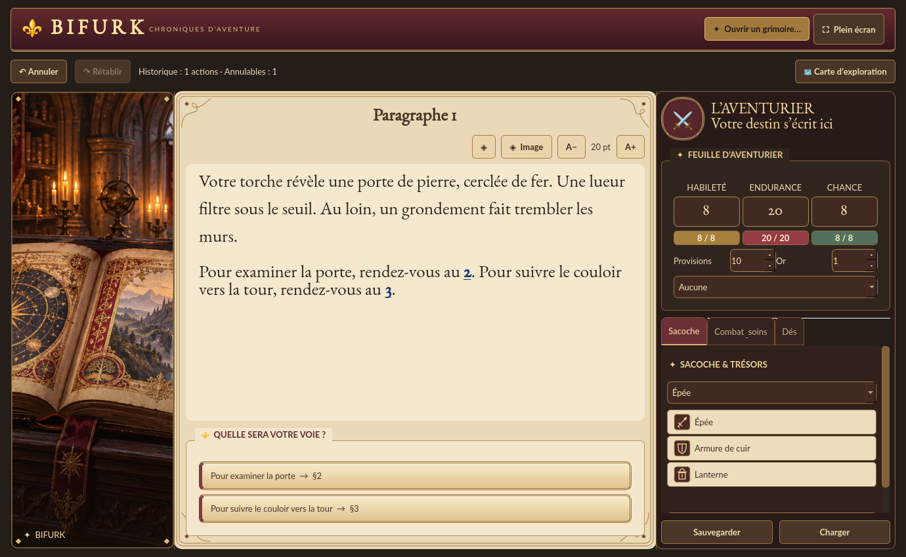
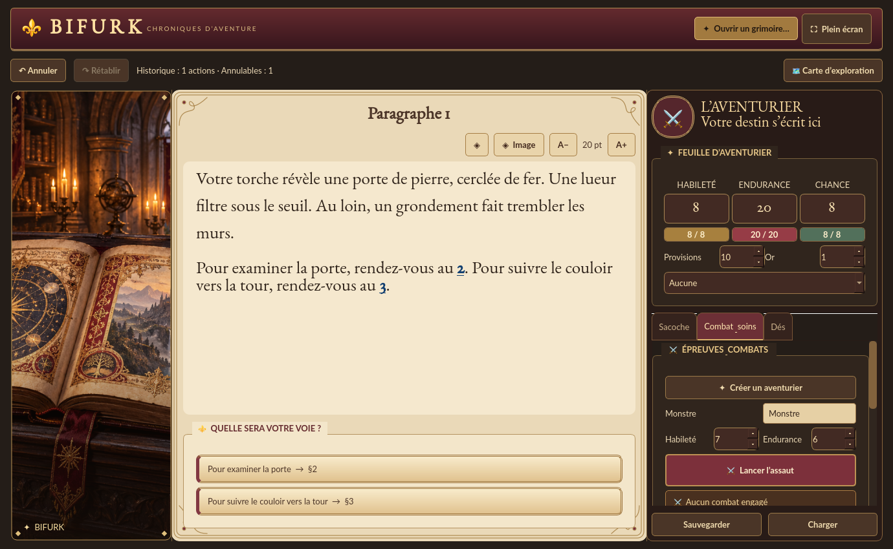

# Le Grimoire

Disposition panoramique de la direction choisie : bordeaux, or patiné et page ivoire,
avec une bibliothèque fantastique illustrée plutôt qu’un fond de formulaire.
L’illustration occupe une colonne redimensionnable à gauche du récit ; la fiche
d’aventurier et l’inventaire compact sont à droite.





Ces captures utilisent un court récit de démonstration original, sans extrait du PDF privé.

## Utilisation

- Importer le PDF avec **Ouvrir un grimoire**.
- Créer le personnage depuis **Combat & soins**, ou charger une sauvegarde.
- Choisir une destination sur les cartes sous le récit ; les longs libellés reviennent à la ligne.
- À l’ouverture d’un livre catalogué, sa couverture apparaît à gauche, sans fenêtre supplémentaire. Ensuite, les illustrations des paragraphes prennent le relais ; la couverture sert de fond en leur absence. Un double-clic sur l’image ouvre son agrandissement.
- Le bouton **Image** masque le bandeau pour libérer de la place. Les images cataloguées
  du livre remplacent le décor et restent intégralement cadrées ; le bouton d’agrandissement
  ouvre toujours la vue détaillée. La bibliothèque est un décor générique, pas une scène du livre.
- La sacoche utilise des lignes compactes. **Gérer les objets…** déplie l’ajout et le retrait ; les noms des objets restent visibles.
- La fiche affiche valeurs et jauges numériques. Les onglets **Sacoche**, **Combat & soins**
  et **Dés** regroupent les commandes. La navigation manuelle par numéro se trouve dans **Dés**.
- Les panneaux peuvent défiler séparément dans les petites fenêtres ; le plein écran reste accessible par F11.

## Tester sous Windows

Dans PowerShell, depuis le dossier du projet :

```powershell
git fetch origin
git switch fix/grimoire-illustrations
git pull --ff-only
.\.venv\Scripts\python.exe -m pip install -r requirements.txt
.\.venv\Scripts\python.exe main.py
```

Vérifier la lecture, les choix et le défilement à 930 × 650 puis en plein écran ;
masquer l’illustration, changer la taille du texte, ouvrir les trois onglets,
charger une sauvegarde et résoudre un combat. Pour le PDF catalogué, vérifier
qu’une illustration apparaît dans la page et que son agrandissement fonctionne.

```powershell
$env:QT_QPA_PLATFORM = "offscreen"
.\.venv\Scripts\python.exe -m unittest discover -s tests -v
Remove-Item Env:QT_QPA_PLATFORM
```

L’illustration `assets/grimoire-library.png` a été générée pour cette interface.
Les emblèmes de l’inventaire sont dessinés en vecteur et ne dépendent pas des polices emoji du système.
Validation graphique effectuée avec Qt hors écran sous Linux ; le rendu Windows reste à vérifier localement.
