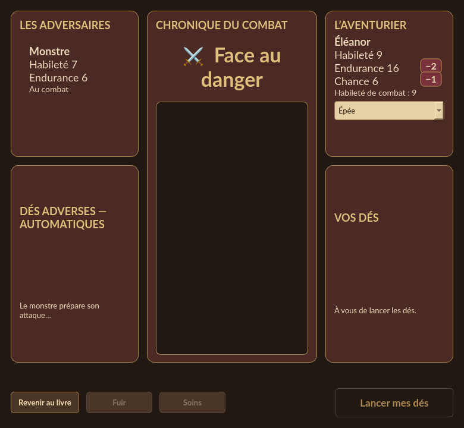

# Variations animées des caractéristiques

Les variations d’**Habileté**, d’**Endurance** et de **Chance** apparaissent dans
un petit cartouche près de leur valeur : gain doré avec un signe **+**, perte
bordeaux avec un signe **−**. Le signe reste lisible indépendamment de la couleur.

Sur la feuille, le cartouche apparaît près de la jauge ; dans le combat, il se
place à droite de la ligne du héros. Les valeurs numériques sont mises à jour
immédiatement. Le cartouche monte légèrement, reste lisible puis s’efface sur
1,8 seconde. Il ne bloque ni les clics ni la suite du combat.

Les variations rapprochées d’une même action se cumulent : un souffle infligeant
un point puis une blessure de deux points affichent un bilan de **−3**. Un nouvel
assaut possède son propre bilan. Une potion rétablissant 18 à 20 affiche **+2**,
sans annoncer les points qui dépasseraient le maximum.

La création, le chargement et les restaurations de l’historique synchronisent
les valeurs silencieusement. Rafraîchir une fenêtre ou changer le thème ne
rejoue pas une variation déjà affichée.

## Maintenance

`stat_feedback.py` observe les valeurs déjà appliquées par le moteur. Ses badges
sont des enfants de la fenêtre, transparents aux clics, avec une animation Qt
non bloquante. Leurs couleurs viennent du thème. Chaque fenêtre garde sa référence
pour ignorer les rafraîchissements identiques ; elle supprime les effets périmés
lors d’une synchronisation silencieuse.

Le contrôleur attribue un identifiant visuel aux actions pour regrouper leurs
effets imbriqués. Cet identifiant et les animations sont exclus des sauvegardes.
La présentation ne consomme aucun hasard et ne modifie aucune règle. Le placement
dans le texte riche du combat suit la ligne réelle, y compris avec un nom long
ou contenant des caractères Unicode.
